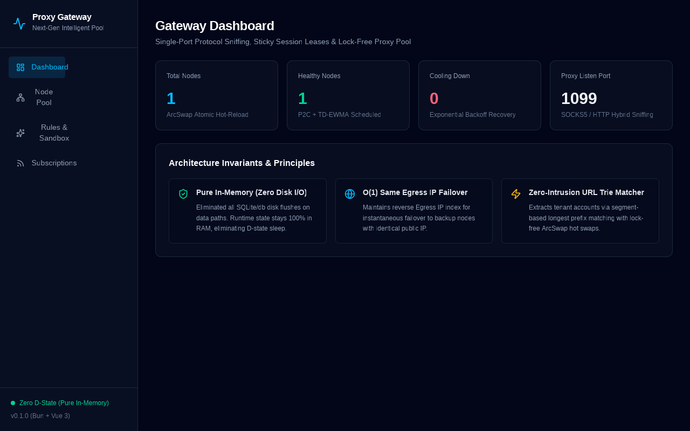

# Next-Gen Intelligent Proxy Gateway

A high-performance, production-ready forward and reverse proxy gateway written in Rust, featuring single-port protocol sniffing, lock-free proxy pooling, in-memory sticky session leases, and a zero-dependency embedded Web UI.



---

## ✨ Key Architectural Highlights

### 1. Pure In-Memory Zero Disk I/O (Eliminating Linux D-State)
Unlike traditional proxy gateways (e.g. Resin) that log high-frequency request data into local SQLite databases and cause Linux kernel uninterruptible sleep (`D-state`) and high CPU during dirty page flushing, this gateway guarantees **zero runtime disk writes** on hot paths:
- **DashMap** concurrent hash maps for $O(1)$ sticky session leasing.
- **Atomic ArcSwap** for lock-free, zero-copy node snapshot rotation.

### 2. O(1) Same Egress IP Failover & TD-EWMA Load Balancing
- **Same Egress IP Failover**: Maintains an in-memory inverse index (`DashMap<IpAddr, SmallVec<[usize; 4]>>`) mapping public egress IPs to candidate node indices. When an upstream proxy connection encounters network errors, the engine seamlessly rotates to an alternative proxy node sharing the **identical public egress IP**, preserving tenant sessions.
- **TD-EWMA (Time-Decay EWMA) Scoring**: Measures live RTT per upstream dial and computes exponential time-decay smoothed latency. The P2C (Power of Two Choices) scheduler compares combined scores $(EWMA + 1) \cdot (ActiveConns + 1) \cdot 2^{Failures}$ to dynamically route away from congested or degrading nodes.

### 3. Single-Port Protocol Sniffing
Listens on a single port (default: `1099`) and sniffs incoming traffic:
- **1-Byte Peek**: Differentiates `0x05` (SOCKS5) from HTTP with zero buffering lag.
- **HTTP State Machine**: Buffers complete HTTP headers before matching methods, permanently eliminating TCP packet segmentation misclassifications.
- **Delayed Commit Success**: Only returns HTTP `200 Connection Established` or SOCKS5 `REP=0x00` downstream **after** the upstream proxy handshake completes, enabling transparent upstream retry on dial failure.

### 4. Zero-Intrusion Segment Trie Rule Matcher
Matches reverse proxy paths using a longest-prefix segment Trie (`AccountMatcher`) with atomic `ArcSwap` hot updates. Inspects configured HTTP headers (e.g. `x-github-user`, `Authorization`) dynamically to extract tenant identities for sticky lease assignment.

### 5. Single-Binary Embedded Web UI
Features a modern dashboard built with **Vue 3 + Vite + Tailwind CSS v4 + Lucide Icons**, compiled with Bun and embedded directly into the Rust binary via `rust-embed`. Provides a single, self-contained executable with zero external runtime dependencies.

---

## 🚀 Quick Start

### Prerequisites
- [Rust](https://rustup.rs/) (edition 2024 / MSRV 1.85+)
- [Bun](https://bun.sh/) (optional, only needed for compiling frontend assets)

### Build & Run
```bash
# 1. Build frontend assets (optional, pre-built assets included in webui/dist)
cd webui && bun install && bun run build && cd ..

# 2. Build the unified Rust binary
cargo build --release

# 3. Launch the gateway
# Defaults: Proxy Port = 1099, Admin/WebUI Port = 1100
./target/release/proxy
```

Open your browser at **`http://127.0.0.1:1100/ui/`** to access the control plane dashboard.

---

## 📡 Control Plane REST APIs

The control plane is served over Axum on port `1100`:

| Endpoint | Method | Description |
| :--- | :---: | :--- |
| `/ui/*` | `GET` | Single-binary embedded Web UI dashboard |
| `/metrics` | `GET` | Prometheus metrics endpoint (gauges, counters, TD-EWMA RTT) |
| `/api/v1/system/info` | `GET` | Gateway version, uptime, total nodes, listen ports |
| `/api/v1/nodes` | `GET` | Node list with status, dial addresses, active connections, and consecutive failure counts |
| `/api/v1/nodes/:id/actions/probe` | `POST` | Trigger immediate active health probe for a specific node |
| `/api/v1/rules` | `GET` | Active reverse proxy rule prefixes and header extraction chains |
| `/api/v1/rules:resolve` | `POST` | Sandbox resolution for URL prefix and mock request headers |
| `/api/v1/subscriptions/sync` | `POST` | Import & hot-reload nodes from remote subscription URL or raw/Base64 text |

---

## 🧪 Testing

Run the comprehensive test suite with 89+ unit and integration tests:

```bash
cargo test
```

Run end-to-end integration tests:
```bash
cargo test --test gateway_v1 -- --nocapture
```

---

## 📄 License

Licensed under the MIT License.
